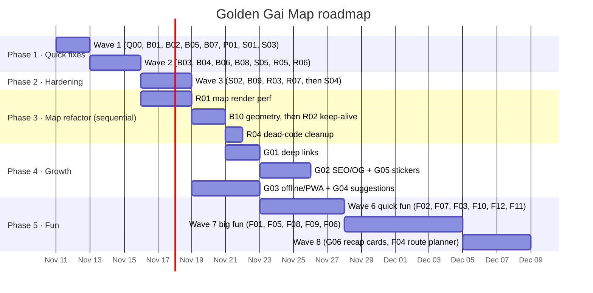
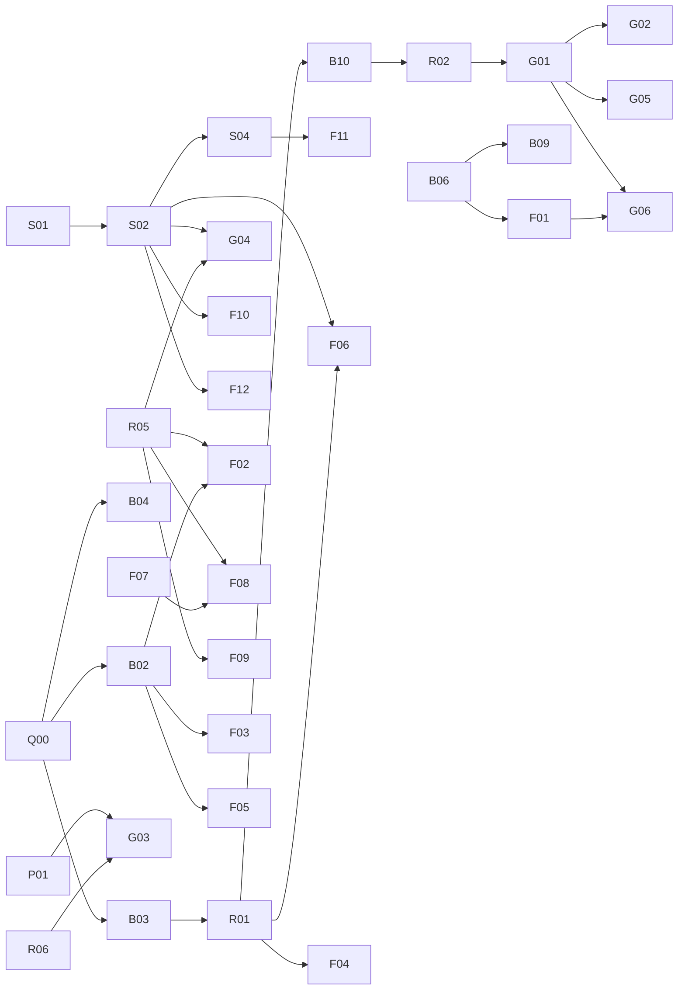

# Golden Gai Map: Improvement Plan

Everything from the November 2026 code review is here as **42 self-contained tasks**: bug fixes, hardening, refactors, growth features and fun features. Each task file in [`tasks/`](tasks/) is written so a subagent can pick it up cold, together with the shared [`AGENT_BRIEF.md`](AGENT_BRIEF.md).

- **Sizes:** S = under 2 h of agent time · M = 2–4 h · L = 4–6 h. "Review" is roughly how long *you* need to check the result. That means looking at screenshots, clicking through the change, and reading the summary.
- **Total:** ~110 agent-hours, ~20–25 hours of your review time. With 3–5 agents running in parallel, that's about **6 weeks** at a relaxed pace (1–2 h of review per day).

---

## How to run a task with a subagent

1. Pick the next task from the **Waves** below (everything in a wave can run at the same time).
2. Give the subagent this prompt (swap the task ID):

   > Read `plans/AGENT_BRIEF.md`, then implement `plans/tasks/B02-open-now-midnight.md`. Work in an isolated worktree branched from the integration branch (currently `claude/amazing-lamport-youilx`). Follow the brief's verification steps and finish with the summary format it describes. Do not work on anything outside this task.

3. When it's done, merge its branch into the integration branch **one task at a time**, then tick it off in the tracker below.
4. **Merge-hot files**: `src/App.vue`, `src/components/GoldenGaiMap.vue`, `src/composables/useI18n.js`, `server/index.js`, `server/migrate.js`. Most conflicts are trivial appends (translation keys, route mounts, new migrations). **Migration numbers can collide.** If two tasks both add `015-…`, renumber the later one when you merge it, before it is ever deployed.
5. Tasks that rework `GoldenGaiMap.vue` (**R01 → B10 → R02**, later **F04/F06**) must run **one after another**, never in parallel.

---

## Easiest first (what to start with)

These are small, low-risk and independent, and they fix real user-facing problems:

| # | Task | Size | Why first |
|---|------|------|-----------|
| 1 | [Q00](tasks/Q00-test-harness.md) Test harness | S | 1 h; every later task adds tests to it |
| 2 | [B07](tasks/B07-jst-clock.md) Tokyo-time clock | S | 45 min, visible, zero risk |
| 3 | [B01](tasks/B01-review-submit.md) Drawing-only reviews fail silently | S | Users are losing reviews right now |
| 4 | [B02](tasks/B02-open-now-midnight.md) "Open Now" wrong after midnight | S | Wrong info at peak hours |
| 5 | [B06](tasks/B06-safe-storage.md) Safe localStorage | S | One bad value can blank the whole site |
| 6 | [B05](tasks/B05-bios.md) BIOS blink + fast boot | S | Returning users wait less |
| 7 | [S01](tasks/S01-deploy-env.md) Deploy env + trust proxy | S | Probably fixes the empty feed; stops one person's bad guesses locking everyone out of admin |
| 8 | [P01](tasks/P01-image-diet.md) Image diet (24 MB → ~3 MB) | S–M | Biggest speed win for phones on roaming data |
| 9 | [S03](tasks/S03-upload-hardening.md) Upload hardening | S | Closes an XSS path |
| 10 | [B08](tasks/B08-i18n-gaps.md) i18n gaps | S | Japanese mode still shows some English text |

---

## Timeline

Assumes ~1–2 h of your review per day and 3–5 agents running in parallel. Week 1 starts whenever you kick off Wave 1.

| Week | What lands | What you'll notice |
|------|------------|--------------------|
| **1** | Waves 1–2: all quick bug fixes, image diet, Win95 dialogs, code splitting, deploy fixes | Site loads much faster; reviews, Open Now, search and filters behave consistently; no more browser `alert()` popups |
| **2** | Wave 3 + R01: rate limits, review moderation, partition sync, chat scroll, touch-draggable windows, map performance | You can moderate spam; the map feels snappier; tablets can drag windows |
| **3** | B10, R02, R04, G01, start of G02/G03/G04 | **Shareable bar links**; map remembers zoom; partition badges centred |
| **4** | G02–G05 finish, Wave 6 | Link previews with bar names and images; works offline / installable; "Suggest edit"; door stickers; Roulette, Screensaver, Tonight timeline, Guestbook, curated news, Doodle gallery |
| **5** | Wave 7 | Stamp Passport + achievements, Gai-chan reactions + Rules Quiz, Control Panel (themes/sounds/accessibility), "Last Order" mini-game, live night-activity glow |
| **6** | Wave 8 + buffer | Shareable recap cards, bar-hop route planner; slack for fixes from your testing |

---

## Waves (what can run in parallel)

Run everything in a wave at the same time; merge in the listed order.

**Wave 1** (start here). Q00 first (it's ~1 h), then the rest in parallel:
`Q00` → `B01` · `B02` · `B05` · `B07` · `P01` · `S01` · `S03`

**Wave 2**: `B03` · `B04` · `B06` · `B08` · `S05` · `R05` · `R06`
(Merge B06 before B08; both touch many files.)

**Wave 3**: `S02` · `B09` · `R03` · `R07` → then `S04` (needs S02)

**Map track** (one at a time, can overlap Wave 3): `R01` → `B10` → `R02` → `B11` → `B12` → `R04`

**Wave 4–5 (growth)**: `G01` → (`G02` · `G05`) and, in parallel, `G03` · `G04`

**Wave 6 (quick fun)**: `F02` · `F07` · `F03` · `F10` · `F12` · `F11`

**Wave 7 (big fun)**: `F01` · `F05` · `F08` · `F09` · `F06`
(F06 touches the map. Don't run it alongside anything else that edits `GoldenGaiMap.vue`.)

**Wave 8**: `G06` (needs F01) · `F04` (needs R01; map-heavy, run alone)

### Dependency graph

---

## Tracker

Tick these off as they merge. "Review" is your time; "Agent" is the subagent's.

### Phase 1: Quick fixes & foundations (~16 agent-h)
| ✓ | ID | Task | Size | Agent | Review | Depends on |
|---|----|------|------|-------|--------|-----------|
| ✅ | [Q00](tasks/Q00-test-harness.md) | Vitest test harness | S | 1 h | 15 m | – |
| ✅ | [B01](tasks/B01-review-submit.md) | Drawing-only reviews fail silently | S | 1 h | 15 m | – |
| ✅ | [B02](tasks/B02-open-now-midnight.md) | "Open Now" wrong after midnight | S | 1.5 h | 15 m | Q00 |
| ✅ | [B03](tasks/B03-unify-filters.md) | One shared filter function (map/drawer/directory agree) | M | 3 h | 30 m | Q00 |
| ✅ | [B04](tasks/B04-search.md) | Search: no 8-cap on highlights, kana/full-width matching | S–M | 2 h | 20 m | Q00 |
| ✅ | [B05](tasks/B05-bios.md) | BIOS double-blink + fast boot for regulars | S | 1 h | 10 m | – |
| ✅ | [B06](tasks/B06-safe-storage.md) | Safe localStorage helper | S | 1 h | 10 m | – |
| ✅ | [B07](tasks/B07-jst-clock.md) | Taskbar clock in Tokyo time | S | 45 m | 5 m | – |
| ✅ | [B08](tasks/B08-i18n-gaps.md) | i18n gaps / duplicate keys | S | 1 h | 15 m | – |
| ✅ | [B09](tasks/B09-partition-sync.md) | New bars missing from partitions; stale cache | S–M | 2 h | 20 m | B06 |
| ✅ | [P01](tasks/P01-image-diet.md) | Image diet (24 MB → ~3 MB) | S–M | 2 h | 20 m | – |

### Phase 2: Backend hardening (~10 agent-h)
| ✓ | ID | Task | Size | Agent | Review | Depends on |
|---|----|------|------|-------|--------|-----------|
| ✅ | [S01](tasks/S01-deploy-env.md) | Docker env passthrough, trust proxy, DB error handler, health check | S | 1 h | 15 m | – |
| ✅ | [S02](tasks/S02-rate-limits-feed.md) | Rate limits on public writes; feed abuse + refresh schedule | M | 3 h | 30 m | S01 |
| ✅ | [S03](tasks/S03-upload-hardening.md) | Upload type checks, safe filenames, nosniff | S | 1.5 h | 15 m | – |
| ✅ | [S04](tasks/S04-review-moderation.md) | Review moderation (delete/hide/report) | M | 3 h | 30 m | S02 |
| ✅ | [S05](tasks/S05-bars-route-correctness.md) | Bars route transactions/validation; chat prune | S | 1.5 h | 15 m | – |

### Phase 3: Performance & refactors (~18 agent-h)
| ✓ | ID | Task | Size | Agent | Review | Depends on |
|---|----|------|------|-------|--------|-----------|
| ✅ | [R01](tasks/R01-map-render-perf.md) | Map: hover separated from geometry; declarative colours | L | 6 h | 45 m | B03 |
| ✅ | [B10](tasks/B10-map-geometry.md) | Partition badge centres; pan correct after rotation | M | 3 h | 30 m | R01 |
| ✅ | [R02](tasks/R02-keep-map-alive.md) | Keep map alive between views | S–M | 2 h | 15 m | R01 |
| ✅ | [B11](tasks/B11-map-touch-gestures.md) | Map touch gestures: rotate, drag and pinch when rotated (found in B10) | M | 3 h | 30 m | B10, R02 |
| ✅ | [B12](tasks/B12-desktop-map-zoom.md) | Desktop map drag/wheel/fit under the 1.25 CSS zoom (found in B10/R02/B11) | S–M | 2 h | 20 m | B11 |
| ✅ | [R03](tasks/R03-chat-scroll.md) | Chat: cheap watcher, don't yank scroll | S | 45 m | 10 m | – |
| ☐ | [R04](tasks/R04-dead-code.md) | Dead code & data cleanup | S | 1 h | 15 m | late |
| ✅ | [R05](tasks/R05-win95-dialogs.md) | Win95 dialog system (replace alert/confirm/prompt) | M | 3 h | 20 m | – |
| ✅ | [R06](tasks/R06-code-split.md) | Lazy-load heavy windows | S | 1 h | 10 m | – |
| ✅ | [R07](tasks/R07-window-drag.md) | Pointer-event window drag + keep on screen | S | 1.5 h | 10 m | – |

### Phase 4: Growth (~19 agent-h)
| ✓ | ID | Task | Size | Agent | Review | Depends on |
|---|----|------|------|-------|--------|-----------|
| ✅ | [G01](tasks/G01-deep-links.md) | Shareable deep links `/bar/<slug>` + Share button | M | 4 h | 30 m | B03, R02 |
| ✅ | [G02](tasks/G02-seo-og.md) | Link previews, sitemap, hreflang, JSON-LD | M–L | 5 h | 45 m | G01, S01 |
| ☐ | [G03](tasks/G03-pwa-offline.md) | Offline mode + "GAI OS Setup Wizard" install | M | 4 h | 30 m | P01, R06 |
| ☐ | [G04](tasks/G04-edit-suggestions.md) | "Suggest an edit" + admin inbox | M | 4 h | 30 m | S02, R05 |
| ☐ | [G05](tasks/G05-door-sticker-qr.md) | Printable door sticker / QR per bar | S | 2 h | 15 m | G01 |

### Phase 5: Fun & engagement (~45 agent-h)
| ✓ | ID | Task | Size | Agent | Review | Depends on |
|---|----|------|------|-------|--------|-----------|
| ☐ | [F02](tasks/F02-roulette.md) | Roulette.exe: random bar picker | S–M | 2 h | 15 m | B03, R05, B02 |
| ☐ | [F07](tasks/F07-screensaver.md) | Screensaver ("Neon Alley") | S–M | 2 h | 10 m | – |
| ☐ | [F03](tasks/F03-tonight-timeline.md) | "Who's open tonight" timeline | M | 3 h | 20 m | B02, B03 |
| ☐ | [F10](tasks/F10-guestbook-counter.md) | About window: guestbook + hit counter | S–M | 3 h | 20 m | S02 |
| ☐ | [F12](tasks/F12-feed-alternative.md) | Curated news feed (no X dependency) | M | 3 h | 20 m | S01, S02 |
| ☐ | [F11](tasks/F11-doodle-gallery.md) | Doodle gallery | S–M | 2 h | 15 m | S04 |
| ☐ | [F01](tasks/F01-passport.md) | Stamp Passport + achievements | M–L | 5 h | 40 m | B06, B03 |
| ☐ | [F05](tasks/F05-gaichan-reactions.md) | Gai-chan reactions + Rules Quiz certificate | M–L | 5 h | 40 m | B02 |
| ☐ | [F08](tasks/F08-control-panel.md) | Control Panel: themes, wallpaper, sounds, accessibility | M | 4 h | 30 m | R05, F07 |
| ☐ | [F09](tasks/F09-mini-game.md) | Original mini-game "Last Order" | M | 4 h | 20 m | R05 |
| ☐ | [F06](tasks/F06-night-activity.md) | Live night-activity glow on map | M | 3 h | 20 m | R01, S02 |
| ☐ | [G06](tasks/G06-recap-cards.md) | Shareable "My Night" recap cards | M | 3 h | 20 m | F01, G01 |
| ☐ | [F04](tasks/F04-route-planner.md) | Bar-hop route planner | L | 6 h | 45 m | R01, B03 |

---

## Where each review finding went

| Review finding | Task |
|----------------|------|
| Drawing-only reviews silently fail; JSON body limit mismatch | B01 |
| Open Now wrong after midnight | B02 |
| Filters disagree (drawer ignores AND; directory excludes unknown price) | B03 |
| Search highlights capped at 8 | B04 |
| BIOS double blink interval | B05 |
| Unguarded `JSON.parse(localStorage)` | B06 |
| Taskbar clock not in JST | B07 |
| Hard-coded English, duplicate `search` key | B08 |
| New bars missing from partitioned buildings; stale partition cache | B09 |
| Partition badge centre ignores rotation; pan ignores user rotation | B10 |
| 24 MB of images; 3.9 MB BIOS logo preloaded | P01 |
| `CORS_ORIGIN`/`TWITTER_BEARER_TOKEN` never reach the container; no trust proxy; no pool error handler; whole repo mounted into the DB container | S01 |
| Feed account endpoint abusable; feed never scheduled; stampede; reviews/chat/admin not rate-limited | S02 |
| Uploads keep the original extension, no type check | S03 |
| No way to remove reviews | S04 |
| PATCH not transactional / NaN id; POST ignores fields; inactive bars public; chat prune per message; partition PUT unvalidated | S05 |
| Hover recomputes all partition geometry; 7 `setTimeout` colour watchers; imperative DOM colours | R01 |
| Map destroyed on every view switch; no refit on resize; `setTimeout(200)` hack | R02 |
| Chat deep watcher, scroll yank, duplicate `beforeunload` listener, unhandled history promise | R03 |
| Stale `sql/`, unused data JSON, biased shuffle | R04 |
| `window.prompt` shows admin password; alert/confirm break the look | R05 |
| 373 kB main chunk | R06 |
| Mouse-only window drag; windows lost off-screen | R07 |
